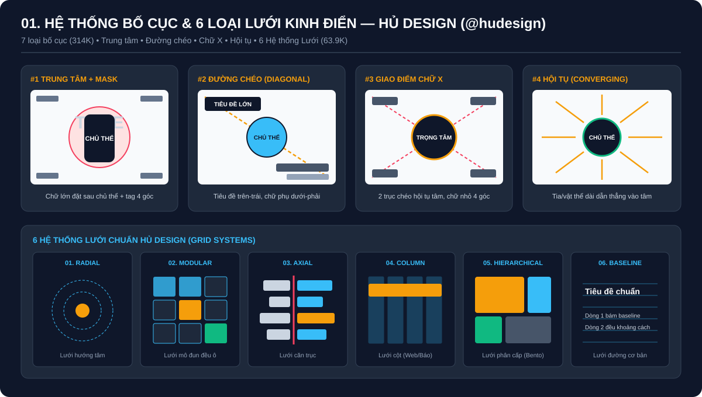
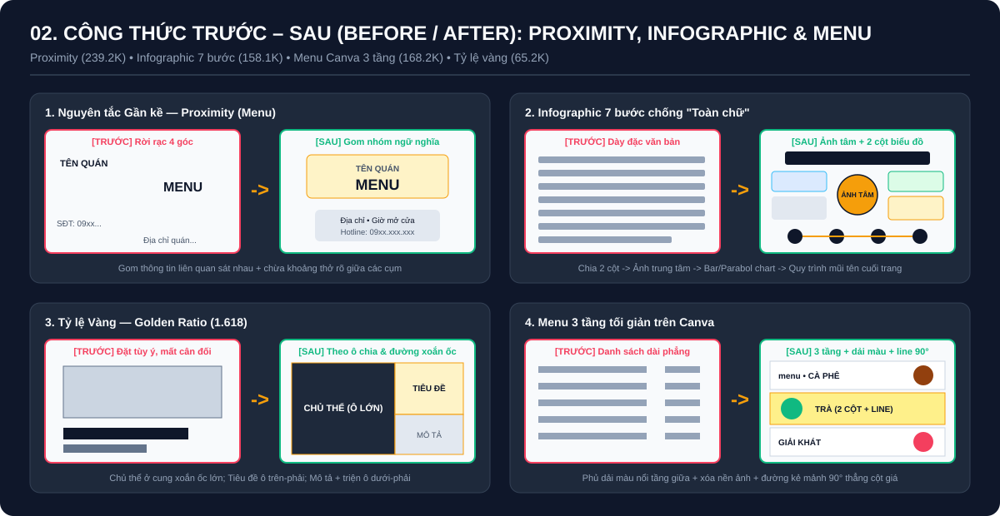
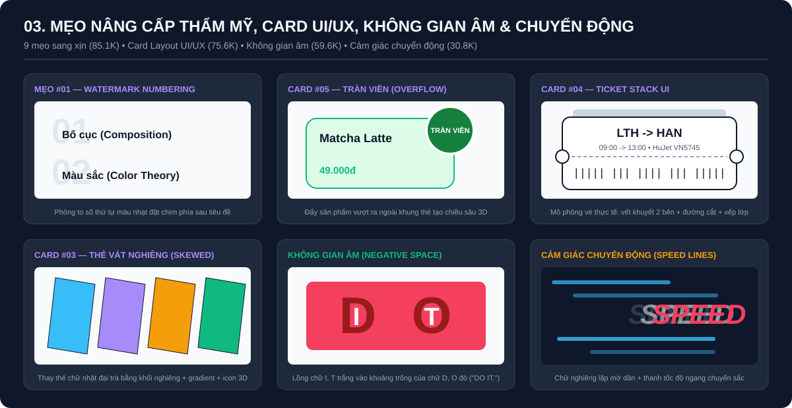
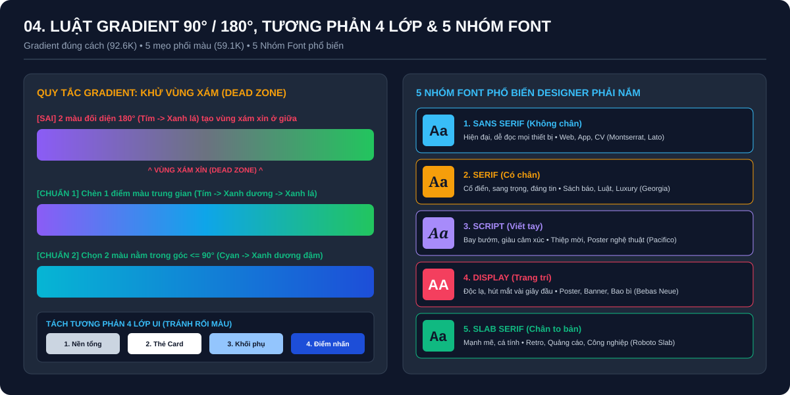

# Hủ Design Visual Skill (`@hudesign`)

Codex skill đóng gói toàn bộ hệ thống công thức thiết kế đồ họa, bố cục, lưới, Card UI/UX, Gradient, phối màu và Typography phân tích trực tiếp từ kênh TikTok **Hủ Design (`@hudesign`)** (`43.5K` follower • `241K` thích • `47` bài đăng • `3` danh sách phát).

## Có gì trong skill?

### Bộ sơ đồ minh họa trực quan (SVG Blueprints) & Visual Playbook
- **4 sơ đồ vector SVG độ nét cao** hiển thị trực tiếp ngay trên GitHub: Hệ thống 9 Bố cục & 6 loại Lưới, Công thức Trước–Sau Thực chiến (Proximity, Infographic 7 bước, Tỷ lệ vàng, Menu 3 tầng), Card UI/UX & Mẹo nâng cấp thẩm mỹ, và Luật Gradient `90° / 180°` + 5 Nhóm Font.
- **Visual Playbook chuẩn 4 cột (*"Xem gì trước?"*)** ánh xạ mọi bài toán thiết kế sang sơ đồ minh họa, mã công thức, mã video gốc và bất biến cần khóa.









[Đọc Visual Playbook](skills/hudesign-design-skill/references/visual-playbook.md) · [Mở Visual Lab HTML](skills/hudesign-design-skill/references/visual-lab.html) · [Xem CSS Recipes](skills/hudesign-design-skill/references/css-recipes.md) · [Sổ cái 25 Video tham khảo (JSON)](skills/hudesign-design-skill/references/reference-video-ledger.json) · [Danh mục đủ 47 bài @hudesign](00_CHANNEL_CATALOG.md)

### Kiến trúc Chuẩn Codex Skill (`skills/hudesign-design-skill/`)
- `skills/hudesign-design-skill/SKILL.md`: Định nghĩa skill lõi kèm **Cổng Kiểm Tra Thiết Kế 5 Bước** và **5 Bất Biến Cấm Vi Phạm**.
- `skills/hudesign-design-skill/agents/openai.yaml`: Cấu hình giao diện agent chuẩn Codex.
- `AGENTS.md` + `schemas/hudesign_formulas.json`: Bộ luật quyết định (Decision Engine) và cơ sở dữ liệu JSON 18 công thức máy đọc.
- `formulas/01..05.md`: 5 sổ tay chuyên đề chi tiết (Bố cục, 6 Hệ thống Lưới, Card UI & Thẩm mỹ, Phối màu/Gradient/Font/10 Phong cách, Checklist QA 10 điểm).

### Cài skill vào Codex

Trong Codex, dán trực tiếp câu lệnh sau để cài skill từ kho GitHub này:

> Hãy cài skill từ repo `Tuyen2004-08/hudesign-design-skill` (thư mục `skills/hudesign-design-skill`).

Hoặc clone trực tiếp qua GitHub CLI:
```bash
gh repo clone Tuyen2004-08/hudesign-design-skill
```

## Dùng sau khi cài

Gọi skill bằng câu lệnh mẫu trong Codex:
```text
Dùng skill hudesign-design-skill. Đọc SKILL.md, references/visual-playbook.md và references/css-recipes.md.
Thiết kế [Landing Page / Poster / Card UI / Menu / Infographic] cho [tên dự án], tuân thủ đủ 5 cổng kiểm tra thiết kế và 10 điểm QA trong formulas/05_software_shortcuts_and_qa.md.
```

## Phạm vi & Giới hạn
- Dữ liệu công thức được trích xuất trực tiếp từ 25 video/bài trượt trọng tâm và chỉ mục đủ 47 bài đăng công khai trên kênh `@hudesign` (mọi mã video được lưu trong `reference-video-ledger.json` và `00_CHANNEL_CATALOG.md` để đối chiếu trực tiếp trên TikTok).
- 2 video phụ đề chạy liên tục (*07 mẹo tinh tế P1* và *08 mẹo tinh tế P2*) đã trích xuất các quy tắc hiển thị chính (viền chữ dày, khử vùng xám gradient, chống chữ phẳng, tương phản chữ sáng trên nền sáng) và có thể mở rộng thêm bất cứ lúc nào.
