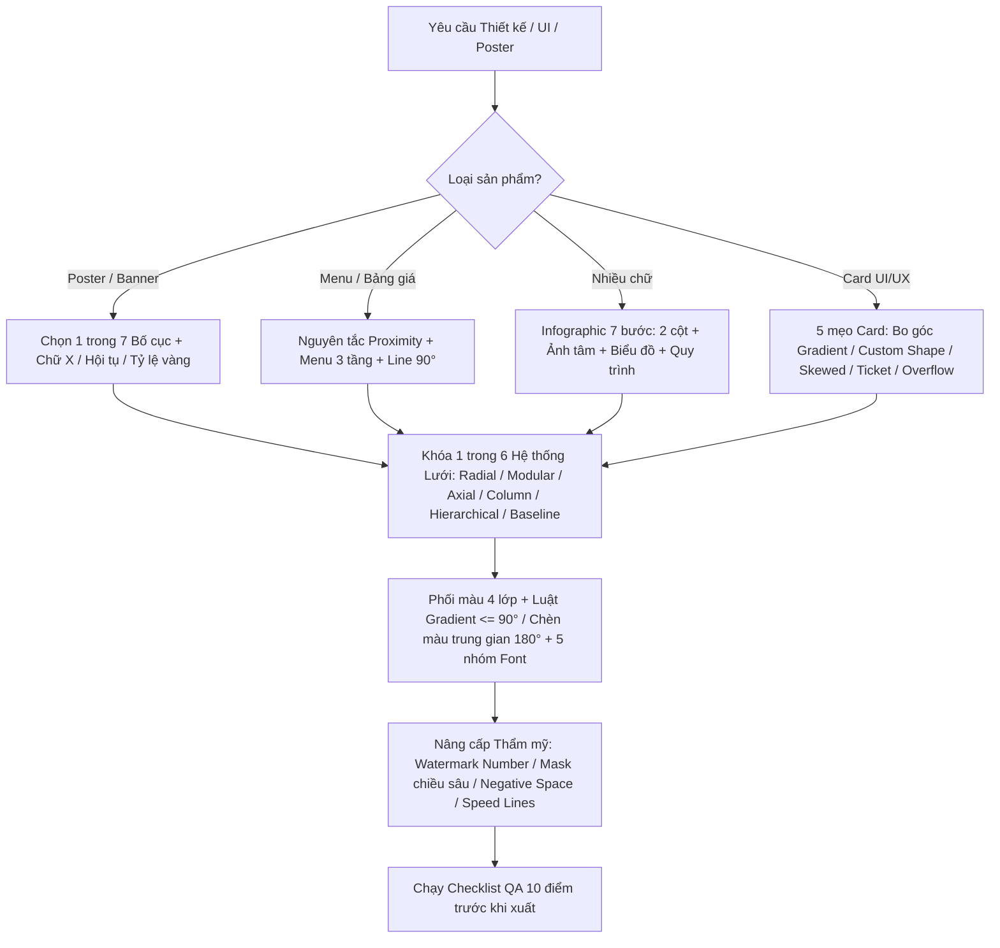

# Hủ Design (`@hudesign`) — Kho Skill & Công Thức Thiết Kế Cho Codex

Kho tri thức thiết kế được phân tích trực tiếp từ kênh TikTok **Hủ Design (`@hudesign`)** (`43.5K` follower • `241K` lượt thích • `47` bài đăng • `3` danh sách phát) và hệ sinh thái **Hudesign (`hudesign.site`)**, chuẩn hóa thành công thức **Trước – Sau (Before/After)**, sơ đồ trực quan Mermaid, JSON Schema và bộ luật vận hành (`AGENTS.md` + `SKILL.md`) để nạp trực tiếp cho **Codex**.

## Cấu trúc Kho Skill

| Đường dẫn | Vai trò |
| :--- | :--- |
| `AGENTS.md` | Bộ luật thực thi & Ma trận quyết định thiết kế (Decision Engine) cho Codex |
| `SKILL.md` | Chuẩn Agent Skill (YAML frontmatter + quy trình 5 bước) |
| `00_CHANNEL_CATALOG.md` | Danh mục đầy đủ 47 bài đăng trên `@hudesign` theo 3 playlist kèm mã video gốc |
| `formulas/01_layout_and_composition.md` | 7 loại bố cục + Trung tâm, Đường chéo, Chữ X, Hội tụ, Tỷ lệ vàng, Proximity, Infographic & Menu Canva |
| `formulas/02_grid_systems.md` | 6 hệ thống lưới (`Radial`, `Modular`, `Axial`, `Column`, `Hierarchical`, `Baseline`) |
| `formulas/03_visual_polish_and_ui_cards.md` | 9 mẹo sang xịn + 6 mẹo newbie + 5 mẹo Card UI/UX + Mẹo tinh tế (P1/P2) + Không gian âm + Chuyển động |
| `formulas/04_color_gradient_typography.md` | 5 mẹo phối màu + Luật Gradient góc <= 90° & khử vùng xám 180° + Tâm lý 9 màu + 5 nhóm Font + 10 phong cách |
| `formulas/05_software_shortcuts_and_qa.md` | Checklist QA 10 điểm Trước–Sau, quy trình Canva/AI/PS & Prompt lệnh chuẩn cho Codex |
| `schemas/hudesign_formulas.json` | Cơ sở dữ liệu JSON có cấu trúc toàn bộ công thức để Codex parse tự động |

## Bản đồ Luồng Quyết Định Thiết Kế (Codex Workflow)



## Cách nạp cho Codex

Prompt gọi nhanh trong Codex sau khi clone repo `Tuyen2004-08/hudesign-design-skill`:
```text
Đọc AGENTS.md và schemas/hudesign_formulas.json. Thiết kế [poster / landing page / menu / card UI / infographic] cho [dự án] theo đúng công thức Hủ Design, kiểm tra đủ 10 điểm QA trong formulas/05_software_shortcuts_and_qa.md trước khi xuất kết quả.
``` chuẩn hóa cho Codex
