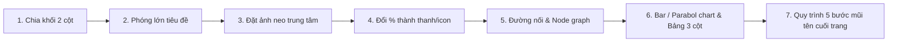

# 01. Công Thức Bố Cục & Phân Cấp Thị Giác (Layout & Composition)

## A. 7 Loại Bố Cục Thường Thấy Trong Thiết Kế Đồ Họa
- **Video tham khảo:** `@hudesign` — `video/7646024611628420359` (*314K lượt xem*)

| STT | Tên bố cục | Bản chất cấu trúc | Khi nào Codex nên chọn |
| :-: | :--- | :--- | :--- |
| 1 | **Bố cục Trung tâm (Center)** | Neo chủ thể vào đúng tâm khung hình | Poster sản phẩm đơn lẻ, hero banner cần nhận diện ngay |
| 2 | **Bố cục 1/3 (Rule of Thirds)** | Chia khung `3×3`, đặt chủ thể tại 4 giao điểm vàng | Poster quảng cáo cần khoảng thở cho cụm chữ tiêu đề một bên |
| 3 | **Bố cục Đường chéo (Diagonal)** | Dẫn mắt chéo từ góc trên-trái xuống dưới-phải | Poster cần sự năng động, nhịp chảy tự nhiên, tránh cứng nhắc |
| 4 | **Bố cục Đường cong (Curved)** | Sắp xếp phần tử theo đường cong mềm (chữ S / C) | Mỹ phẩm, F&B, thời trang, du lịch cần cảm giác uyển chuyển |
| 5 | **Bố cục Khung (Frame)** | Dùng khung viền/hình khối bao quanh để khoanh vùng tiêu điểm | Poster sự kiện, thiệp, ưu đãi cần sự chỉn chu, tập trung |
| 6 | **Bố cục Đối xứng (Symmetry)** | Cân bằng gương hai nửa trái–phải qua trục dọc | Thương hiệu cao cấp, kiến trúc, bìa sách, so sánh 2 vế |
| 7 | **Bố cục Lặp lại (Repetition)** | Lặp lại mô-đun hình khối/thẻ đồng nhất theo nhịp | Lưới sản phẩm, bộ sưu tập, danh mục dịch vụ |

## B. Công Thức Chi Tiết 5 Bố Cục Trọng Điểm (Before → After)

### 1. Bố cục Trung tâm Nâng cao (`video/7582220655031274770` • 127.6K)
- **Trước:** Đặt chủ thể giữa nền trơn, tiêu đề trên đầu, giá bên dưới → dễ phẳng và đơn điệu.
- **Sau (2 công thức nâng cấp):**
  - *Cách 1 (Lồng lớp tiền cảnh–hậu cảnh):* Phóng lớn chủ thể ở trung tâm (ly matcha), đặt tiêu đề cực lớn (`craving matcha`) **nằm phía sau chủ thể** để chủ thể đè nhẹ lên chữ tạo chiều sâu; đẩy giá/tag phụ gọn ra 4 góc.
  - *Cách 2 (Mask hình khối nền):* Đặt hình tròn hoặc chữ nhật bo góc màu nổi (vòng tròn đỏ trong poster `BLACK FRIDAY`) ngay sau người mẫu ở tâm, xếp cụm thông tin phụ (`70% OFF`, ngày diễn ra) cân đối 4 góc.

### 2. Bố cục Đường chéo (`video/7521727954192223495` • 219.6K)
- **Trước:** Xếp tiêu đề và chữ phụ thẳng hàng dọc cứng nhắc.
- **Sau:** Đặt **tiêu đề lớn ở góc trên bên trái**, giữ chủ thể chính ở trục giữa và đặt **khối chữ phụ ở góc dưới bên phải** bao quanh chủ thể.

### 3. Bố cục Giao điểm Trọng tâm / Chữ "X" (`video/7524317963789372690` • 148.6K)
- **Trước:** Dàn trải tiêu đề và văn bản ngang/dọc làm loãng lực hút.
- **Sau:** Phóng to chủ thể trung tâm, thu nhỏ yếu tố phụ và đặt theo cặp ở **2 góc đối diện hoặc 4 góc trên 2 đường chéo cắt nhau thành chữ X**. Biến thể: xoay dọc bố cục `90°` và đặt dòng chữ chạy dọc ranh giới ảnh.

### 4. Bố cục Hội tụ (`video/7526137835141729543` • 51.1K)
- **Trước:** Chủ thể đứng trơ trọi, thiếu điểm dẫn mắt.
- **Sau:** Dùng shape tia phóng xạ, vật thể tuyến tính (đũa, hành lá), chữ xoay chéo hoặc vòng tròn đồng tâm hướng thẳng vào chủ thể ở giữa.

### 5. Tỷ lệ Vàng 1.618 (`video/7529573401598446866` • 65.2K)
- **Công thức:** Phủ lưới xoắn ốc tỷ lệ vàng: Bản dọc đặt chủ thể vào vùng xoắn ốc tập trung, tiêu đề góc trên-phải, văn bản phần thân dưới. Bản ngang đặt ảnh chủ thể lớn bên trái theo cung xoắn ốc lớn, tiêu đề chính ô trên-phải, mô tả ô dưới-phải.

## C. Bố Cục Thực Chiến: Proximity, Infographic & Menu 3 Tầng

### 6. Nguyên tắc Gần kề — Proximity (`video/7689793745599892754` • 239.2K)
- **Trước:** Tên quán, chữ `"MENU"`, địa chỉ, SĐT đặt tản mạn rời rạc khắp bìa.
- **Sau:** Gom Tên quán + `"MENU"` thành Cụm 1; Địa chỉ + SĐT thành Cụm 2 gọn phía dưới, chừa khoảng trống rõ giữa 2 cụm.

### 7. Công thức 7 Bước Trình bày Infographic Nhiều Chữ (`video/7531679531468442887` • 158.1K)

### 8. Công thức Menu 3 Tầng Tối Giản bằng Canva (`video/7526475657501609224` • 168.2K)
- **Tầng 1 (Trên):** Chữ `"menu"` serif nghiêng góc trên-trái + danh sách món + ảnh sản phẩm đã xóa nền.
- **Tầng 2 (Giữa):** Phủ **dải màu vàng nhạt** ngang toàn hàng để tách nhịp, đặt ảnh bên trái và chia danh sách món 2 cột bên phải.
- **Tầng 3 (Dưới):** Nền sáng, nhóm món bên trái + ảnh bên phải.
- **Căn gióng:** Kẻ đường viền mảnh (line ngang và dọc xoay `90°`) tách nhóm và giữ cột giá thẳng hàng.
