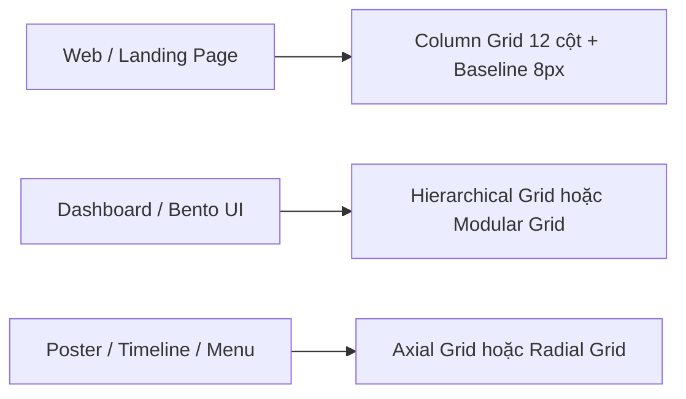

# 02. Công Thức 6 Hệ Thống Lưới (Grid Systems)

- **Video tham khảo chính:** `@hudesign` — `video/7665740962018118919` (*63.9K lượt xem*)
- **Video bổ trợ:** `video/7664239235318271250` (*Mục 06: Hệ thống lưới*)

## Bảng Công Thức 6 Hệ Thống Lưới Chuẩn Hủ Design

| STT | Tên Tiếng Anh | Tên Tiếng Việt | Cấu trúc hình học | Ứng dụng tốt nhất cho Codex / Designer |
| :-: | :--- | :--- | :--- | :--- |
| **01** | **RADIAL GRID** | Lưới hướng tâm | Vòng tròn đồng tâm kết hợp trục tia tỏa ra từ điểm trung tâm | Poster tập trung 1 chủ thể, infographic sơ đồ tư duy |
| **02** | **MODULAR GRID** | Lưới mô đun | Giao cắt giữa cột dọc và hàng ngang tạo ma trận ô đều nhau | Dashboard UI, catalog sản phẩm, e-commerce |
| **03** | **AXIAL GRID** | Lưới căn trục | Một trục chính (dọc hoặc nghiêng) làm xương sống, nội dung bám 2 bên | Timeline sự kiện, menu tối giản, poster typography |
| **04** | **COLUMN GRID** | Lưới cột | Chia bề ngang thành 2, 3, 4 hoặc 12 cột dọc kèm gutter đều nhau | Website responsive (`12-col CSS Grid`), tạp chí, infographic 2 cột |
| **05** | **HIERARCHICAL GRID** | Lưới phân cấp | Phân chia khối bất đối xứng theo độ ưu tiên (Chính → Phụ → Bổ trợ) | Bento Grid UI, landing page hero, poster có 1 điểm nhấn lớn |
| **06** | **BASELINE GRID** | Lưới đường cơ bản | Hệ thống đường kẻ ngang đều nhau theo `line-height` (`4px`/`8px`) | Bài viết dài, bảng giá, nhiều cột chữ cần thẳng chân dòng |

## Quy tắc chọn lưới nhanh cho Codex

