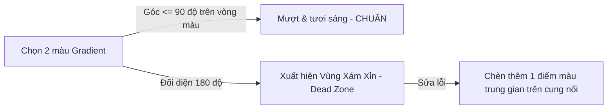

# 04. Công Thức Phối Màu, Gradient, 5 Nhóm Font & 10 Phong Cách Thiết Kế

## A. Luật Gradient Chuẩn & 5 Mẹo Phối Màu (`video/7671229776681585927` • 92.6K & `video/7539160968979401992` • 59.1K)

### 1. Luật Vàng cho Gradient

- **Quy tắc góc <= 90°:** Chọn 2 màu nằm trong khoảng góc `<= 90°` trên vòng tròn màu (Cyan → Xanh dương đậm).
- **Khử vùng xám 180°:** Nếu phối 2 màu đối diện `180°` (Tím ↔ Xanh lá, Xanh dương ↔ Cam), bắt buộc chèn **1 điểm màu trung gian** (Tím → Xanh dương → Xanh lá).
- **Nền sản phẩm tối giản/công nghệ:** Tránh nền gradient cầu vồng rực rỡ lấn át sản phẩm → ưu tiên **nền tối (xám đen)** hoặc **gradient ánh sáng nhẹ** phía sau cạnh sản phẩm.
- **Hòa trộn Gradient lên ảnh:** Phủ dải gradient đa điểm hòa trộn lên chân dung tạo hiệu ứng ánh sáng nghệ thuật.

### 2. 4 Nguyên tắc Phối màu UI & Branding
1. **Đơn sắc (Monochromatic):** Đổi sắc độ đậm–nhạt cùng 1 tông màu để tạo chiều sâu.
2. **Liền kề (Analogous):** Kết hợp các màu sát cạnh nhau trên vòng màu để hài hòa, thống nhất.
3. **Bổ sung (Complementary):** Chọn cặp đối diện `180°` (Xanh dương – Cam) cho các mảng tách biệt (nền và CTA).
4. **Giảm số màu & Tách tương phản 4 lớp:** Lớp 1 (Nền xám nhạt) → Lớp 2 (Thẻ trắng) → Lớp 3 (Khối phụ xanh nhạt) → Lớp 4 (Điểm nhấn xanh đậm + chữ trắng).

## B. Tâm Lý Học Màu Sắc Branding (`photo/7530291996859174162` & `photo/7532006799914863880`)

| Màu | Cảm xúc cốt lõi | Ứng dụng & Lưu ý |
| :--- | :--- | :--- |
| **Xanh lá** | Tươi mới, cân bằng, êm dịu | Thiên nhiên, phát triển, an toàn, tài chính |
| **Vàng** | Hạnh phúc, năng động, lạc quan | Nổi bật; cảnh báo không lạm dụng vì dễ gây chói mắt |
| **Đỏ** | Đam mê, năng lượng, nguy hiểm, may mắn | Mãnh liệt; tại Việt Nam & Đông Á đại diện may mắn (Tết) |
| **Cam** | Năng động, nhiệt tình, thân thiện | Thu hút như đỏ nhưng ít áp đảo → rất hợp nút CTA |
| **Hồng** | Lãng mạn, nhẹ nhàng, dễ thương, táo bạo | Millennial pink hiện đại; hot pink táo bạo, nổi loạn |
| **Tím** | Sáng tạo, bí ẩn, hoàng gia, sang trọng | Quyền quý (crypto); tím nhạt hợp làm đẹp & sức khỏe |
| **Nâu** | Ấm áp, vững vàng, thực tế, đáng tin | Cổ điển, truyền thống, lâu đời (cà phê, thủ công) |
| **Xám** | Nghiêm túc, chuyên nghiệp, đáng tin | Trung tính, nền vững chắc cho hệ thống UI |
| **Trắng** | Đơn giản, thanh bình, tinh khiết | Tối giản; quá nhiều dễ lạnh lẽo như bệnh viện |

## C. 5 Nhóm Font Phổ Biến (`photo/7528406911268424968`)
1. **SANS SERIF** *(Không chân)* — Gọn gàng, hiện đại, dễ đọc mọi thiết bị → Web, app, CV, logo công nghệ (`Helvetica, Montserrat, Lato`).
2. **SERIF** *(Có chân)* — Cổ điển, sang trọng, đáng tin → Sách báo, luật, ngân hàng, thương hiệu cao cấp (`Times New Roman, Georgia, Garamond`).
3. **SCRIPT** *(Viết tay)* — Bay bướm, giàu cảm xúc → Thiệp mời, poster nghệ thuật (`Pacifico, Great Vibes, Dancing Script`).
4. **DISPLAY** *(Trang trí)* — Độc lạ, thu hút mạnh giây đầu → Poster, banner, social, bao bì (`Bebas Neue, Bungee, Lobster`).
5. **SLAB SERIF** *(Chân to bản)* — Mạnh mẽ, cá tính → Retro, quảng cáo, công nghiệp (`Rockwell, Museo Slab, Roboto Slab`).

## D. 10 Phong Cách Thiết Kế Thịnh Hành (`photo/7526950267040959762`)
1. **Bold Minimalism** • 2. **Metallics** (*Future Dust*) • 3. **Pixels** • 4. **Shape** • 5. **Textured Grains** • 6. **Maximalist Illustration** • 7. **Retro Serif Typography** • 8. **Gothic-Inspired Badges & Crests** • 9. **Handcrafted Elements** • 10. **AI-Powered Design**.
