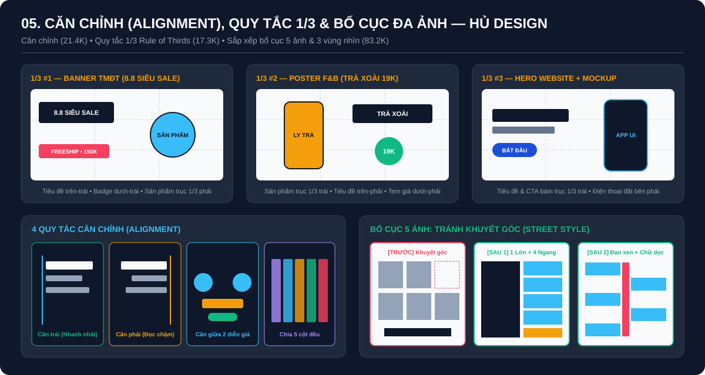
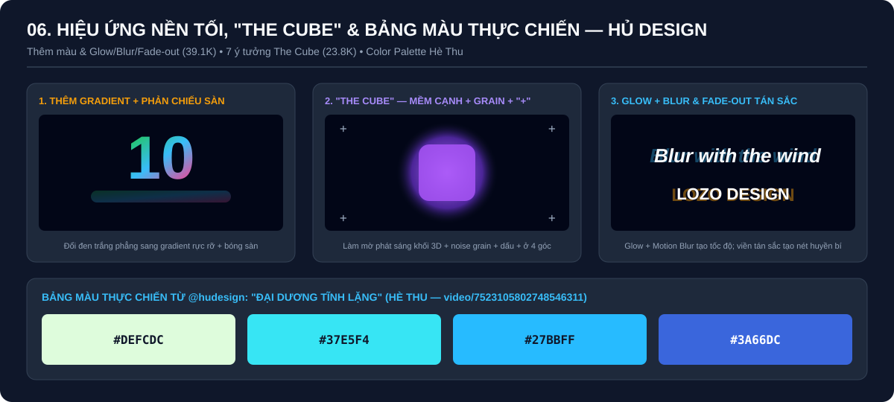

# 06. Công Thức Căn Chỉnh, Quy Tắc 1/3, Bố Cục Đa Ảnh & Hiệu Ứng Nền Tối

## A. 4 Quy Tắc Căn Chỉnh (Alignment — `video/7555877133571198226` • 21.4K)
1. **Căn lề trái (Đọc nhanh nhất):** Dùng một trục gióng dọc xuyên suốt toàn bộ tiêu đề, mô tả và địa chỉ để tạo trật tự gọn gàng.
2. **Căn lề phải (Nhấn mạnh nhưng đọc chậm hơn):** Dùng trục gióng phải khi cần cân đối với ảnh bên trái, lưu ý tốc độ quét mắt chậm hơn căn trái.
3. **Căn giữa đối xứng + Khối màu nổi:** Phù hợp banner Talkshow có 2 diễn giả đặt đối xứng hai bên, tiêu đề + nút `ĐĂNG KÝ NGAY` ở trục giữa; hoặc đặt **khối màu nổi** sau thông tin quan trọng (*Matcha Latte*).
4. **Chia cột dọc đều & Căn chữ so le:** Chia 5 cột dọc đều nhau cho poster nhiều nhân vật (*The Beast War*), hoặc căn chữ so le trên ảnh chia đôi hai mảng tương phản (*Between The Sea And The Desert*).

## B. Quy Tắc 1/3 — Rule Of Thirds (`video/7534703958217035015` • 17.3K)
Chia khung hình bằng 2 đường ngang + 2 đường dọc đều nhau (`3×3`) tạo 4 giao điểm vàng:
- **Kịch bản 1 — Banner TMĐT (`8.8 SIÊU SALE`):** Tiêu đề ở giao điểm trên-trái, cụm badge (`FREESHIP`, `VOUCHER 150K`) ở dưới-trái, sản phẩm dọc trục 1/3 phải.
- **Kịch bản 2 — Poster F&B (`TRÀ XOÀI`):** Sản phẩm chính dọc trục 1/3 trái, tiêu đề ở 1/3 trên-phải, tem tròn giá `19K` ở giao điểm dưới-phải.
- **Kịch bản 3 — Hero Banner Website:** Tiêu đề và nút CTA bám trục dọc 1/3 trái + hai đường ngang 1/3, mockup điện thoại đặt bên phải.

## C. Sắp Xếp Bố Cục Chiều Sâu & Xử Lý 5 Ảnh (`video/7528024154184977671` • 83.2K)
- **Tạo chiều sâu Poster sự kiện (*Tennis Tournament*):** Đưa chủ thể vào trung tâm, gom thông tin gọn theo trục, thêm chữ nền cực lớn (`TENNIS`) và vật thể tiền/hậu cảnh làm mờ (bóng tennis blur).
- **Cân bằng 3 vùng dọc (*Cắm trại Mùa Hè*):** Giữ vùng giữa lớn nhất để dẫn mắt từ dưới lên, đặt 2 cụm thông tin phụ đối xứng hai bên trái–phải.
- **Sửa lỗi lưới 5 ảnh bị khuyết góc (*Street Style Showcase*):**
  - *Cách 1:* 1 ảnh lớn toàn chiều cao bên trái + 4 ảnh ngang xếp chồng bên phải, tiêu đề góc dưới-phải.
  - *Cách 2:* 5 ảnh xếp thành các dải chéo đan xen trái–phải, chạy tiêu đề dọc ở chính giữa.

## D. Hiệu Ứng Nền Tối, "The Cube" & Bảng Màu Thực Chiến

- **Nâng cấp đồ họa nền tối (`video/7522097536799149330` • 39.1K):**
  - Đổi số/khối đen trắng đơn điệu sang **gradient rực rỡ + phản chiếu mặt sàn** (`10`).
  - Tạo **đường hầm phát sáng 3D** (`M`), kết hợp **Glow + Motion Blur** tạo cảm giác chuyển động (*"Blur with the wind"*), và dùng **viền tán sắc mờ dần (fade-out)** tạo vẻ huyền bí (*"LOZO DESIGN"*).
- **7 ý tưởng "The Cube" (`video/7523597829923769608` • 23.8K):**
  - Làm mềm cạnh phát sáng khối 3D + thêm **noise/grain** + đặt dấu `+` ở 4 góc (`THE CUBE`).
  - Nghiêng nhẹ dải sọc gradient, sao chép đối xứng & xoay (`số 8`), kéo khối xếp lớp 3D (`chữ B`), và thêm ánh sáng/bóng đổ lên chữ hình học (`ART`).
- **Bảng màu thực chiến (`video/7523105802748546311`):** **Đại Dương Tĩnh Lặng (Hè Thu):** `#DEFCDC` · `#37E5F4` · `#27BBFF` · `#3A66DC`.
