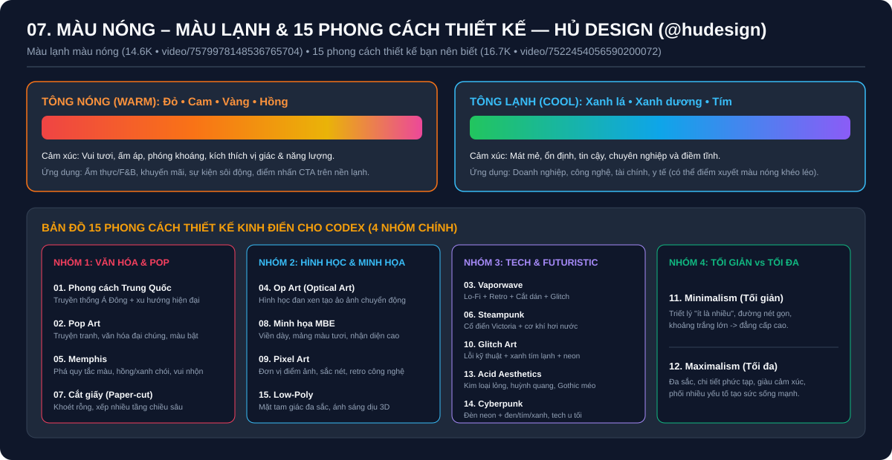

# 07. Quy Tắc Màu Nóng – Màu Lạnh & 15 Phong Cách Thiết Kế Kinh Điển

## A. Quy Tắc Màu Nóng – Màu Lạnh (`video/7579978148536765704` • 14.6K)
- **Phân chia vòng tròn màu:**
  - **Tông Nóng (Warm):** Đỏ, cam, vàng, hồng → tạo cảm giác **vui tươi, ấm áp, phóng khoáng** (ứng dụng mạnh cho ẩm thực/F&B, khuyến mãi, sự kiện sôi động).
  - **Tông Lạnh (Cool):** Xanh lá, xanh dương, tím → tạo cảm giác **mát mẻ, ổn định, chuyên nghiệp** (ứng dụng cho doanh nghiệp, công nghệ, tài chính, y tế).
- **Quy tắc phối chéo tông:** Không cấm dùng màu nóng trong thiết kế tông lạnh (hoặc ngược lại) — chỉ cần giữ **1 tông làm chủ đạo** và dùng tông đối lập làm **điểm nhấn CTA/trọng tâm** một cách khéo léo.

## B. 15 Phong Cách Thiết Kế Bạn Nên Biết (`video/7522454056590200072` • 16.7K)

| STT | Phong cách | Đặc trưng thị giác & Vật liệu | Khi nào Codex nên chọn |
| :-: | :--- | :--- | :--- |
| 01 | **Phong cách Trung Quốc** | Họa tiết văn hóa truyền thống kết hợp xu hướng hiện đại | Âm nhạc, thời trang, phim, quảng cáo mang bản sắc Á Đông |
| 02 | **Pop Art** | Truyện tranh, văn hóa đại chúng, độ tương phản và mảng màu mạnh | F&B, đồ ăn nhanh, chiến dịch truyền thông trẻ trung |
| 03 | **Vaporwave** | Cắt dán + Glitch + Retro + Lo-Fi + Cyberpunk | Poster âm nhạc, sự kiện đêm, thẩm mỹ hoài cổ kỹ thuật số |
| 04 | **Op Art (Optical Art)** | Đường thẳng, đường cong, hình học đan xen tạo ảo ảnh chuyển động | Nền poster nghệ thuật, thời trang, triển lãm thị giác |
| 05 | **Memphis** | Phá quy tắc màu, tông sáng chói (hồng, xanh lá), hình học vui nhộn | Thương hiệu sáng tạo, trẻ trung, đồ họa phẳng hiện đại |
| 06 | **Steampunk** | Cổ điển thời Victoria kết hợp cơ khí hơi nước, vật liệu thô mộc | Game, sách viễn tưởng, bao bì thủ công độc bản |
| 07 | **Cắt giấy (Paper-cut)** | Khoét rỗng nhiều lớp xếp chồng tạo chiều sâu, màu sắc tươi sáng | Thiệp lễ hội, poster nghệ thuật, minh họa kể chuyện |
| 08 | **Minh họa MBE** | Đường viền dày, mảng màu phẳng tươi sáng, nhân vật Q-version đơn giản | Icon UI, landing page thân thiện, nhận diện dễ nhớ |
| 09 | **Pixel Art** | Đơn vị điểm ảnh sắc nét, màu tươi sáng, cảm hứng máy tính sơ khai | Game, sản phẩm công nghệ, merch retro |
| 10 | **Glitch Art** | Hiệu ứng lỗi tín hiệu số, tông xanh tím lạnh kết hợp ánh neon | Poster thời trang, streetwear, sản phẩm xu hướng |
| 11 | **Tối giản (Minimalism)** | Triết lý "ít là nhiều", cấu trúc gọn, khoảng trắng rộng | Thương hiệu cao cấp, SaaS, sản phẩm cần cảm giác đẳng cấp |
| 12 | **Chủ nghĩa Tối đa (Maximalism)** | Đa sắc, nhiều lớp chi tiết phức tạp, giàu cảm xúc | Lễ hội, tạp chí nghệ thuật, thương hiệu cá tính mạnh |
| 13 | **Acid Aesthetics** | Màu huỳnh quang bão hòa cao, kim loại lỏng, laser, font Gothic méo | Âm nhạc điện tử, thời trang avant-garde, poster kích thích thị giác |
| 14 | **Cyberpunk** | Đèn neon, bảng hiệu đô thị, nền đen/tím/xanh dương/xanh lá u tối | Game sci-fi, phần cứng gaming, thế giới công nghệ cao |
| 15 | **Low-Poly** | Bề mặt ghép từ các tam giác đa sắc, ít chi tiết, ánh sáng dịu | Minh họa 3D hiện đại, background công nghệ, đồ họa retro-futuristic |
