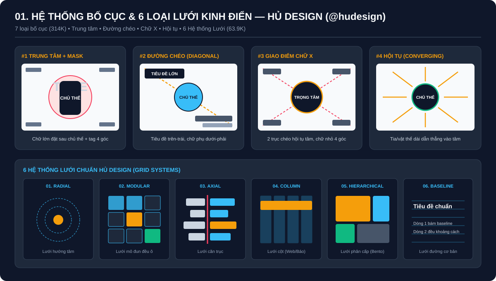
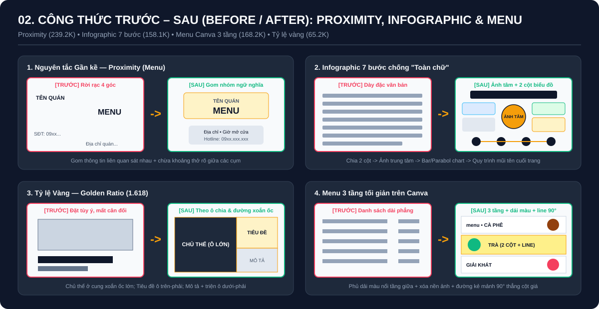
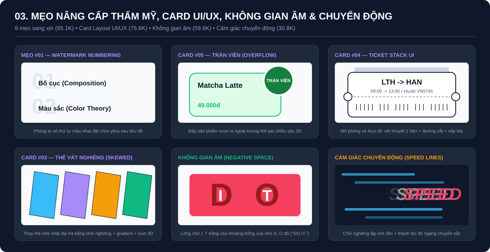
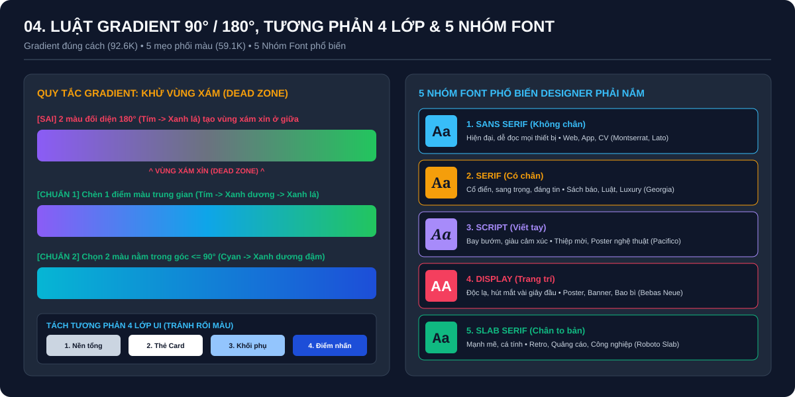

# Visual Playbook — Xem Gì Trước Khi Thiết Kế?

Trước khi viết code giao diện hay dựng layout, tra cứu bảng 4 cột dưới đây để chọn đúng công thức, mở sơ đồ minh họa SVG và đối chiếu video gốc trên kênh `@hudesign` (xem URL đầy đủ trong `reference-video-ledger.json`).

## Bảng Tra Cứu Nhanh (Xem Gì Trước?)

| Bài toán thiết kế mới | Sơ đồ minh họa & Mã video `@hudesign` | Mã công thức | Bất biến cần khóa |
| :--- | :--- | :--- | :--- |
| **Poster / Hero sản phẩm đơn lẻ** | [Sơ đồ Bố cục & Lưới](../assets/diagrams/01_layouts_and_grids.svg) · `video/7646024611628420359` · `video/7582220655031274770` | `LAY-01`, `LAY-02` | Chủ thể nằm tâm, chữ tiêu đề lớn đặt **phía sau** chủ thể hoặc có mask hình khối tạo chiều sâu, tag phụ gọn 4 góc |
| **Poster cần nhịp chảy / lực hút mạnh** | [Sơ đồ Bố cục & Lưới](../assets/diagrams/01_layouts_and_grids.svg) · `video/7521727954192223495` · `video/7524317963789372690` · `video/7526137835141729543` | `LAY-03`, `LAY-04`, `LAY-05` | Trục chéo (trên-trái → dưới-phải), 2 trục chữ X giao tâm, hoặc tia/vật thể tuyến tính hướng vào 1 điểm duy nhất |
| **Poster nghệ thuật / Tỷ lệ vàng** | [Sơ đồ Trước–Sau Thực chiến](../assets/diagrams/02_before_after_practical.svg) · `video/7529573401598446866` | `LAY-06` | Chủ thể nằm ở cung xoắn ốc lớn (`1.618`), tiêu đề ô trên-phải, mô tả ô dưới-phải |
| **Menu / Bảng giá nhiều thông tin** | [Sơ đồ Trước–Sau Thực chiến](../assets/diagrams/02_before_after_practical.svg) · `video/7689793745599892754` · `video/7526475657501609224` | `LAY-07`, `LAY-09` | Gom nhóm Proximity theo ngữ nghĩa; Menu 3 tầng phủ dải màu tách tầng giữa, kẻ line mảnh 90° thẳng cột giá |
| **Trang / Poster quá nhiều chữ** | [Sơ đồ Trước–Sau Thực chiến](../assets/diagrams/02_before_after_practical.svg) · `video/7531679531468442887` | `LAY-08` | Chia 2 cột + ảnh neo tâm + đổi % & bảng thành Bar/Parabol/Node chart + quy trình mũi tên cuối trang |
| **Thiết lập hệ thống Lưới (Web/App/Print)** | [Sơ đồ Bố cục & Lưới](../assets/diagrams/01_layouts_and_grids.svg) · `video/7665740962018118919` | `GRD-01` | Khóa rõ 1 trong 6 lưới (`Radial, Modular, Axial, Column, Hierarchical, Baseline`), mọi cột thẳng chân dòng |
| **Card UI/UX sản phẩm & dịch vụ** | [Sơ đồ Card UI & Polish](../assets/diagrams/03_card_ui_and_polish.svg) · `video/7619709741140413704` · `video/7634899872566512904` | `UI-01`, `POL-01` | Phá khung chữ nhật đại trà: bo góc + vòm gradient, Custom Shape, thẻ vát nghiêng, Ticket Stack hoặc **Card Overflow tràn viền** |
| **Logo / Poster sáng tạo & tốc độ** | [Sơ đồ Card UI & Polish](../assets/diagrams/03_card_ui_and_polish.svg) · `video/7522856606074227975` · `video/7524715684501146887` | `POL-02`, `POL-03` | Lồng hình/chữ trong không gian âm (`DO IT.`); tạo tốc độ bằng chữ nghiêng lặp mờ dần + Speed lines ngang |
| **Phối màu, Gradient & Chọn Font** | [Sơ đồ Gradient, Màu & Font](../assets/diagrams/04_gradient_color_and_fonts.svg) · `video/7671229776681585927` · `video/7539160968979401992` · `photo/7528406911268424968` | `COL-01`, `COL-02`, `TYP-01` | Gradient góc `<= 90°` hoặc chèn điểm trung gian cho cặp `180°`; tách tương phản 4 lớp UI; chọn đúng 1 trong 5 nhóm Font |

## Hình Ảnh Minh Họa Trực Quan

